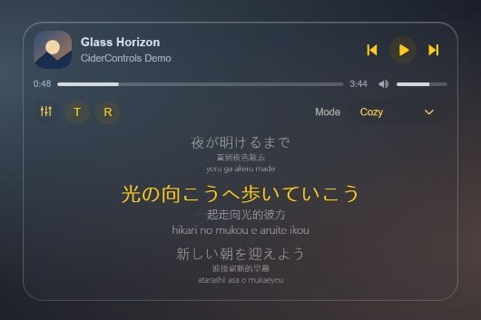
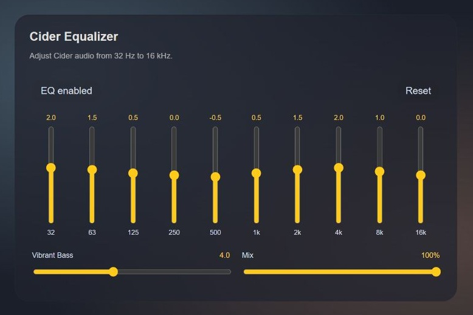

# CiderControls

[繁體中文](README.zh-TW.md)

A Windows desktop user plugin for **Equicord / Equibop** that puts Cider controls above your user panel, including when a voice panel is visible. Version **1.5.0** uses English UI labels by default.


## Screenshots

Component previews using demo playback data. The English version currently displays Chinese translations when available.





## Features

- Previous / play-pause / next, seek and volume, rounded artwork, long-title marquee.
- Click the artwork to expand three synchronized lyric lines. The current line is larger and yellow; translation and romanization use smaller translucent text.
- `T` toggles Chinese translations; `R` toggles romanization. Both choices are saved independently.
- Source-provided word timestamps drive word highlights. Line-only lyrics remain line-synchronized; timestamps are never fabricated.
- NetEase Chinese translations are matched by song title, artist and duration, then aligned to original lyric text. Cider translations are the fallback. Simplified Chinese is displayed as Traditional Chinese; Chinese originals do not get a duplicate translation row.
- Local Japanese romanization with a bundled offline Kuromoji dictionary; existing source readings take priority.
- Off / Gaming / Anti-fatigue / Cozy listening modes and a 10-band EQ with Vibrant Bass and Mix.
- Frosted player / EQ styling. The player is hidden when Cider is unavailable by default.

## Compatibility

Tested with Cider for Windows **4.0.40**, Equibop **3.3.2** and Equicord commit `00abcbeea2ddf4317e02843418f267db62bcb913`. Other versions may require changes. This is a custom desktop plugin, not an official bundled plugin, standalone music player, Android app, or browser extension. Plain Vencord / Vesktop compatibility is not verified.

## Build from source

Use a disposable Equicord checkout. The installer copies this plugin, adds an offline-dictionary packaging hook and copies tests. It does not install or restart your desktop app.

```sh
git clone https://github.com/Equicord/Equicord.git Equicord
cd Equicord
git checkout 00abcbeea2ddf4317e02843418f267db62bcb913
pnpm install --frozen-lockfile
node ../equicord-cider-controls/scripts/install-source.mjs .
pnpm add -w opencc-js@1.3.1 kuroshiro@1.2.1 kuroshiro-analyzer-kuromoji@1.1.0 --ignore-scripts
pnpm build --dev
```

Use the Node / pnpm versions declared by the Equicord checkout. Run commands from its root. After building, `dist/equibop.asar` is the complete Equicord bundle for Equibop, not a loose plugin. Close the app, back up your active `sessionData/equicord.asar`, then replace it with that bundle. Preserve your existing user-data directory and launch from your normal Windows shortcut. This project deliberately provides no automatic profile migration or app restart. Equicord updates can overwrite custom bundles; rebuild after updating.

## Cider setup and EQ bridge

1. Enable Cider's local API at `127.0.0.1:10767` and create an App Token named **Equicord**, with permission for playback, audio, lyrics, configuration and plugin messages. Exact permission labels depend on Cider's version.
2. The native helper reads the existing token from the local `sh.cider.dotnet/spa-config.yml`; you do not paste it into Discord. It prefers an Equicord / Equibop token, then a Discord token, then a suitable scoped token.
3. For EQ writes, zip the **contents** of `cider-eq-bridge` (so `plugin.yml` and `plugin.js` are at the archive root), install through Cider's plugin interface and enable **Equicord EQ Bridge**. Playback, lyrics and listening modes do not require this companion.

The bridge receives allowlisted EQ commands through Cider's authenticated local message API. It does not expose another server or port. EQ changes affect Cider audio and are persisted by Cider; Reset restores the bridge's neutral values.

## Privacy and lyric sources

Playback and EQ commands go to loopback only. Enabling the lyric view can send the current **song title and artist** to `music.163.com` to resolve a matching NetEase translation. Cider may contact its own configured lyric / translation services. Local Japanese conversion does not send lyrics to an additional service. No API keys, account sessions, personal CSS, generated full-client bundles or user settings are included in this repository.

NetEase matching may fail, translations may be missing, and different edits of a recording may not align. Translations are displayed only for matching original lines. Network failures fall back to Cider without replacing the original lyric timing.

## Validation

After running the source installer, run in the Equicord checkout:

```sh
pnpm exec tsc --noEmit
pnpm exec eslint src/userplugins/ciderControls.desktop
node .cider-controls-tests/tests/test-cider.mjs
node .cider-controls-tests/tests/test-cider-features.mjs
node .cider-controls-tests/tests/test-cider-lyrics.mjs
node .cider-controls-tests/tests/test-cider-romanization.mjs
node .cider-controls-tests/tests/test-cider-netease.mjs
```

`test-cider-netease.mjs --live` additionally queries NetEase for a public test track. Automated checks do not prove compatibility with every host version or every lyric source.

## License and credits

GPL-3.0-or-later; existing Vencord / Equicord copyright headers are preserved. See [THIRD_PARTY_NOTICES.md](THIRD_PARTY_NOTICES.md). This project is not affiliated with Cider, Apple, NetEase, Discord or Equicord.
