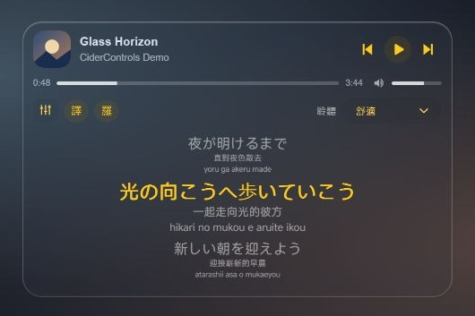
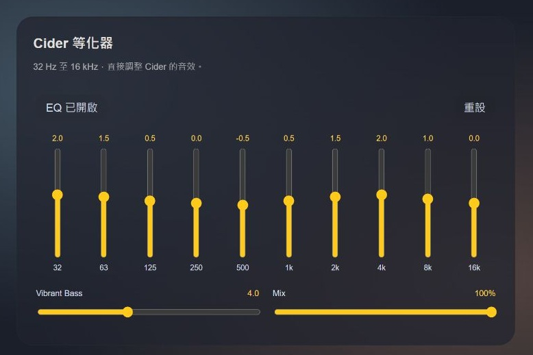

# CiderControls

[English](README.md)

給 Windows **Equicord／Equibop** 的 Cider 控制插件。控制列位於個人區上方，進入語音時仍保持在語音面板上方。**1.5.0 發布版預設為英文介面**。

## 畫面截圖

使用示範歌曲資料的元件預覽；繁體中文畫面取自先前的中文版本。

## 功能

- 上一首、播放／暫停、下一首、播放進度、音量、圓角封面與過長歌名跑馬燈。
- 點封面展開三行同步歌詞；目前一句較大、黃色，前後兩句較小，翻譯與羅馬拼音為透明白色小字。
- `T` 切換中文翻譯，`R` 切換羅馬拼音，分別保存選擇。
- 來源有逐字時間才顯示逐字高亮；只有逐行時間就維持逐行同步。
- 網易雲翻譯依歌名、歌手與時長配對，再對應原文；缺少時沿用 Cider 翻譯。簡體轉繁體，中文原文不重複加翻譯。
- 日文缺少來源讀音時，以內建離線 Kuromoji 字典轉羅馬拼音。
- 聆聽模式：Off、Gaming、Anti-fatigue、Cozy；10 段 EQ、Vibrant Bass 與 Mix。
- 毛玻璃播放器與 EQ；預設在 Cider 未連線時隱藏播放器。

## 相容性與建置

已測試 Cider Windows **4.0.40**、Equibop **3.3.2**、Equicord commit `00abcbeea2ddf4317e02843418f267db62bcb913`。其他版本可能需要調整；尚未驗證原版 Vencord／Vesktop，不支援手機或網頁版。

使用獨立的 Equicord 原始碼副本，Node／pnpm 版本依該專案規定。完整指令見 [英文建置說明](README.md#build-from-source)。`scripts/install-source.mjs` 只複製原始碼、測試與離線字典打包邏輯，不會改你的登入資料、安裝桌面程式或自動重開。

編譯後的 `dist/equibop.asar` 是完整 Equicord 封裝。自行退出 Equibop、備份目前使用的 `sessionData/equicord.asar` 後再替換，使用平常的 Windows 捷徑開啟，保留原本資料目錄。Equicord 更新可能覆蓋自訂封裝，需要重新建置。

## Cider 設定

在 Cider 啟用 `127.0.0.1:10767` 本機 API，建立名稱為 **Equicord** 的 App Token，提供播放、音訊、歌詞、設定與插件訊息所需權限；實際權限名稱依版本為準。插件從本機 `sh.cider.dotnet/spa-config.yml` 讀取現有 Token，不需要貼進 Discord。

EQ 寫入需要伴隨插件 **Equicord EQ Bridge**。將 `cider-eq-bridge` 裡的內容壓成 ZIP，確保根目錄有 `plugin.yml` 與 `plugin.js`，再透過 Cider 插件介面安裝並啟用。一般播放、歌詞與聆聽模式不需要這個橋接。

橋接只透過 Cider 已驗證的本機訊息 API 接收白名單 EQ 操作，不開新伺服器。EQ 會影響 Cider 音效並由 Cider 保存；Reset 使用橋接定義的中性值。

## 隱私與限制

播放和 EQ 指令只連本機。展開歌詞後，可能將目前的**歌名與歌手**送到 `music.163.com` 配對網易雲譯文；Cider 也可能聯絡它自己的歌詞／翻譯來源。本機日文轉寫不會把歌詞送往額外服務。

倉庫不包含你的 API 金鑰、登入憑證、個人 CSS、完整客戶端封裝或設定備份。配對、翻譯與逐字時間取決於來源是否提供，無法保證每首歌都有；只顯示能對應原文的翻譯，原始歌詞時間維持 Cider 來源。

## 授權

GPL-3.0-or-later，保留 Vencord／Equicord 原有版權標頭。第三方套件見 [THIRD_PARTY_NOTICES.md](THIRD_PARTY_NOTICES.md)。本專案與 Cider、Apple、網易雲、Discord、Equicord 沒有官方隸屬關係。
